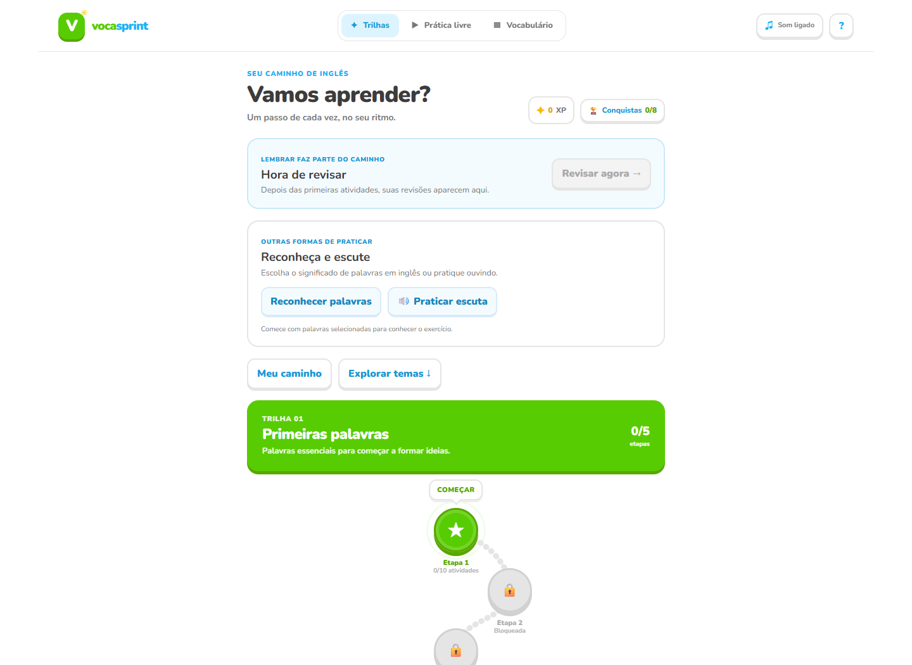
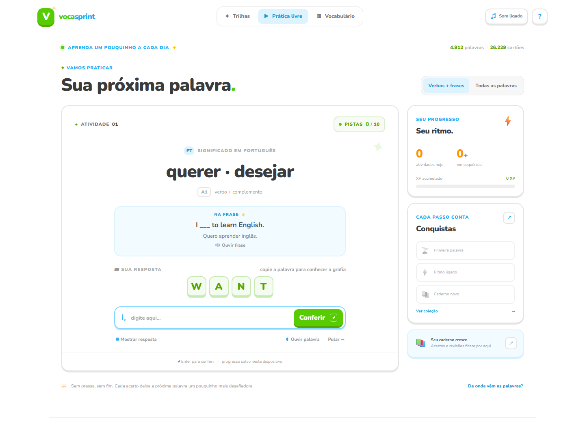

# Voca Sprint

**Voca Sprint** é um jogo de navegador para praticar vocabulário e frases em inglês. A pessoa aprende completando palavras, recuperando significados e revendo o conteúdo em pequenas sessões. O projeto está neste repositório como `duolingo_wordgame` e usa uma interface própria, com trilhas, XP, conquistas e áudio opcional.

[Abrir o jogo publicado](https://duolingowordgame.vercel.app/) · [Ver fontes e créditos](dist/creditos.html)

> A versão publicada pode pedir autenticação enquanto a proteção de acesso do Vercel estiver ativa.

## Capturas do jogo

### Trilhas e caminho de aprendizagem

O mapa mostra a etapa atual, o que já foi concluído e quais etapas serão liberadas em seguida.



### Prática de palavras e frases

Cada rodada combina o significado em português com uma palavra ou frase em inglês. As pistas diminuem conforme a pessoa avança.



## Como o jogo funciona

- **20 trilhas temáticas**, cada uma com cinco etapas de dez atividades.
- As primeiras quatro etapas de cada trilha trabalham palavras e trechos em contexto; a quinta pede a frase completa a partir do significado.
- A prática começa mostrando a palavra para ajudar a aprender sua grafia. Com o avanço, as pistas diminuem até a pessoa escrever sem ajuda, vendo apenas o significado.
- Frases apresentam o uso da palavra em contexto e sua tradução. Depois de um acerto, o jogo destaca a resposta e o significado e espera Enter para avançar.
- Revisões de palavras e frases aparecem ao longo do caminho. Erros e respostas com ajuda voltam para prática; acertos independentes aumentam gradualmente o desafio.
- XP, sequência, etapas concluídas e conquistas acompanham o progresso.
- A prática de reconhecimento e escuta é opcional. O áudio usa a voz em inglês disponível no navegador; o restante do jogo continua funcionando sem ela.
- O catálogo também pode ser explorado e pesquisado na seção **Vocabulário**.

## Progresso e privacidade

O progresso é salvo no `localStorage` do navegador. Não é preciso criar uma conta, mas os dados ficam vinculados àquele navegador e dispositivo. Limpar os dados do navegador pode apagar o progresso.

O jogo diferencia uma resposta independente de uma resposta copiada, revelada ou completada com pistas. Esses apoios ajudam a avançar, mas não contam como lembrança sem ajuda. Uma palavra só é marcada como lembrada depois de um acerto independente em outro dia.

## Executar localmente

Requer Node.js 18 ou mais recente. Não é necessário instalar pacotes.

```sh
git clone https://github.com/Nicollasarcanjo/duolingo_wordgame.git
cd duolingo_wordgame
node scripts/serve.cjs
```

Abra <http://127.0.0.1:4173/>. Para encerrar o servidor, pressione `Ctrl+C` no terminal.

O jogo é uma aplicação estática: a página e os arquivos do app estão em `dist/`. Para publicar no Vercel, configure `dist` como diretório de saída; não há etapa de build nem dependências de instalação.

## Estrutura do projeto

```text
dist/
  index.html              Interface do jogo
  game.css                Estilos da interface e do mapa
  game.js                 Trilhas, rodada, progresso e conquistas
  learning.js             Regras de dificuldade e revisão
  recognition.js          Atividades de reconhecimento e escuta
  catalog.json            Catálogo de palavras, sentidos e exemplos
  *-examples.js           Frases e exemplos em contexto
  *-cards.js              Cartões selecionados para as trilhas
  creditos.html           Fontes e créditos em linguagem simples
scripts/
  serve.cjs               Servidor local simples
  preview.mjs             Servidor local com porta configurável
  prepare-data.mjs        Preparação do catálogo a partir das fontes
  audit-catalog.cjs       Auditoria estrutural do catálogo
  test-learning.cjs       Testes automatizados das regras de aprendizagem
docs/screenshots/         Capturas incluídas neste README
ATTRIBUTION.md             Atribuições e licenças das fontes de dados
```

## Catálogo e fontes

O jogo reúne cerca de **4.900 palavras e 26.000 cartões de significado** entre o catálogo amplo e as seleções usadas nas atividades. As trilhas organizam parte do vocabulário por tema e incluem frases em inglês com tradução para português.

O catálogo combina LexiCore-5000, Wordfreq e o dicionário KOReader inglês–português do Brasil, além de exemplos e curadoria próprios do jogo. Os créditos, links e condições de redistribuição estão em [`ATTRIBUTION.md`](ATTRIBUTION.md), [`dist/creditos.html`](dist/creditos.html) e nos arquivos de aviso e licença dentro de `dist/`. Confira esses arquivos antes de redistribuir o catálogo.

O projeto inclui cartões ainda sem revisão editorial humana completa. `scripts/audit-catalog.cjs` verifica campos ausentes, duplicações e exemplos suspeitos, mas uma auditoria automática não confirma que cada sentido ou exemplo está correto em contexto.

## Tecnologia

- HTML, CSS e JavaScript sem framework.
- Node.js apenas para servir o app localmente e preparar ou auditar os dados.
- `localStorage` para o progresso no dispositivo.
- Web Speech API para reproduzir palavras e frases quando suportada pelo navegador.

## Contribuições

Ao alterar cartões ou fontes, preserve os créditos e as licenças indicados nos arquivos de atribuição. Ao editar as trilhas, mantenha cada etapa com dez atividades e confira se as frases têm tradução correspondente.
